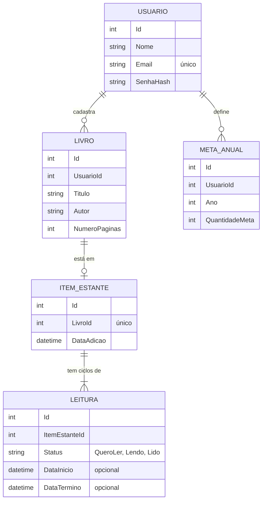

# Sistema de Controle de Leitura
 
API REST em .NET 10 para registrar leituras, acompanhar o status de cada livro e comparar o que foi lido com a meta anual.
 
Projeto do squad **Katherine Johnson** (bootcamp .NET).
 
## 1. Problema, público e por que importa
 
> **Rascunho do squad: confirmar ou ajustar o texto.**
 
Quem lê bastante lembra dos títulos marcantes, mas não do conjunto: o que terminou, o que deixou pela metade e quanto falta para a meta do ano. Sem registro, a resposta depende da memória, e a meta só é lembrada no fim do ano, quando já é tarde para ajustar.
 
**Público:** leitoras que querem acompanhar o que leram e cumprir uma meta anual, seja pessoal, de um clube do livro ou de uma comunidade de leitura.
 
O problema tem três partes: falta de **registro** (leituras espalhadas), falta de **acompanhamento** (sem datas, não há ritmo) e falta de **meta visível** (a meta não é comparada com o que já foi lido).
 
### Perguntas do enunciado
 
| Pergunta | Resposta do squad |
|---|---|
| Quem é a leitora? | _a definir pelo squad_ |
| Em que momento percebe que está atrasada? | _a definir pelo squad_ |
| Meta de livros ou de páginas? Por quê? | **Livros.** O enunciado define o progresso em livros lidos, e a contagem é simples de registrar e de entender. _Confirmar o motivo._ |
| Quanto tempo tem para registrar uma leitura? | _a definir pelo squad_ |
 
## 2. MVP e extras
 
O teste usado: *sem essa funcionalidade, o problema continua sem solução?*
 
**MVP**
- Cadastro e login da usuária (com token).
- Cadastro de livros.
- Adição do livro à estante, com status **Quero ler**.
- Mudança de status respeitando a ordem: Quero ler → Lendo → Lido.
- Meta anual com progresso.
**Extras (fora do MVP)**
- Avaliação com nota e comentário.
- Busca por autora.
- Catálogo compartilhado de livros entre usuárias.
## 3. Modelo de dados
 

 
### Decisões de modelagem
 
- **`ItemEstante` separado de `Leitura`.** O enunciado pede que o livro apareça **uma única vez** na estante (regra 4) e que reler crie uma **nova leitura**, mantendo a anterior como concluída (regra 1). O `ItemEstante` representa o livro estar na estante (único por livro) e cada `Leitura` é um ciclo de leitura dele.
- **O status fica só na `Leitura`.** O `ItemEstante` não guarda status, para não existirem duas fontes da mesma informação. O status atual do livro é o da leitura mais recente.
- **Releitura.** Só é permitida se a última leitura estiver **Lido**. A nova leitura nasce em **Quero ler**, para que haja uma única regra de transição. O enunciado não define isso: é decisão do squad.
- **`DataInicio` opcional.** Uma leitura em Quero ler ainda não começou.
- **Exclusão.** Excluir um livro é recusado se ele está na estante (regras 4 e 8). Retirar o livro da estante apaga as leituras dele.
- **Avaliação** fica fora do MVP e entrará em uma migration própria, ligada à `Leitura` (no máximo uma por leitura).
- **Isolamento por usuária:** todo dado pertence a uma usuária (`Livro.UsuarioId`, `MetaAnual.UsuarioId`). A estante é alcançada pelo livro.
## 4. Regras de negócio
 
1. As etapas seguem a ordem Quero ler → Lendo → Lido. Um livro Lido não volta para Lendo; reler cria nova leitura.
2. Lido exige data de término, que não pode ser anterior à de início.
3. Só se avalia o que foi concluído.
4. Um livro aparece uma vez na estante.
5. A leitura conta para o ano em que foi **concluída**.
6. Progresso da meta: livros lidos no ano; percentual (lidos ÷ meta); média mensal necessária (livros que faltam ÷ meses restantes, contando o mês atual). Meta atingida: média zero.
7. Uma meta por ano por usuária.
8. Livro que está em alguma estante não pode ser excluído.
9. Cada usuária vê apenas os próprios dados.
10. E-mail único e senha com no mínimo 8 caracteres.
## 5. Arquitetura
 
```
Backend/
├── SistemaControleLeitura.Api             → Controllers, Program.cs, configuração
├── SistemaControleLeitura.Application     → Services (regras de negócio)
├── SistemaControleLeitura.Infrastructure  → EF Core, AppDbContext, Repositories, Migrations
└── SistemaControleLeitura.Domain          → Entidades e enums
```
 
Correspondência com as camadas do enunciado:
 
| Enunciado | Projeto |
|---|---|
| Controller | Api |
| Service | Application |
| Repository | Infrastructure |
 
As dependências apontam para dentro: `Api` → `Application` e `Infrastructure` → `Domain`. O `Domain` não depende de nenhum outro projeto.
 
**Tecnologias:** .NET 10, ASP.NET Core Web API, Entity Framework Core 10 com SQLite, Swagger (Swashbuckle).
 
## 6. Como executar localmente
 
**Pré-requisitos:** [.NET 10 SDK](https://dotnet.microsoft.com/download) e a ferramenta do EF Core:
 
```bash
dotnet tool install --global dotnet-ef
```
 
**Passo a passo** (a partir da raiz do repositório):
 
```bash
# 1. Restaurar e compilar
dotnet build
 
# 2. Criar o banco aplicando as migrations
dotnet ef database update -p Backend/SistemaControleLeitura.Infrastructure -s Backend/SistemaControleLeitura.Api
 
# 3. Rodar a API
dotnet run --project Backend/SistemaControleLeitura.Api
```
 
O terminal mostra o endereço da API. Abra `/swagger` nesse endereço para ver a documentação e testar os endpoints. O Swagger só é habilitado no ambiente `Development`, que é o padrão do `dotnet run`.
 
**Configuração:** a connection string `LeituraDb` está em `Backend/SistemaControleLeitura.Api/appsettings.json` e aponta para um arquivo SQLite local (`controle-leitura.db`), criado no passo 2. Não é um segredo. Valores sensíveis, como a chave do token, **não** vão para o repositório: use `dotnet user-secrets` ou variáveis de ambiente.
 
### Migrations
 
Cada mudança no modelo gera uma migration com nome que descreve a mudança:
 
```bash
dotnet ef migrations add NomeDescritivo -p Backend/SistemaControleLeitura.Infrastructure -s Backend/SistemaControleLeitura.Api
```
 
## 7. Fluxo de trabalho do squad
 
- Uma branch por funcionalidade (`feat/...`, `fix/...`) e um Pull Request para cada uma, revisado por outra pessoa antes do merge.
- Commits no padrão [Conventional Commits](https://www.conventionalcommits.org/pt-br/), por exemplo `feat: adiciona mudança de status da leitura`.
- Tarefas organizadas em um quadro Kanban no GitHub Projects, com uma issue por funcionalidade do MVP.
## 8. Status
 
| Item | Situação |
|---|---|
| Estrutura em camadas e banco (migration `Inicial`) | Pronto |
| Cadastro e login | _a fazer_ |
| Livros | _a fazer_ |
| Estante e mudança de status | _a fazer_ |
| Meta anual | _a fazer_ |
| Testes automatizados | _a fazer_ |
| Publicação | _a fazer_ |
 
## 9. Squad
 
| Integrante | Responsabilidade |
|---|---|
| Mariana | Configuração do projeto e do banco; Livros |
| Bianca | Cadastro e conta |
| Yasmin | Estante e estatus |
| Rosana | Meta anual e progresso |
 
